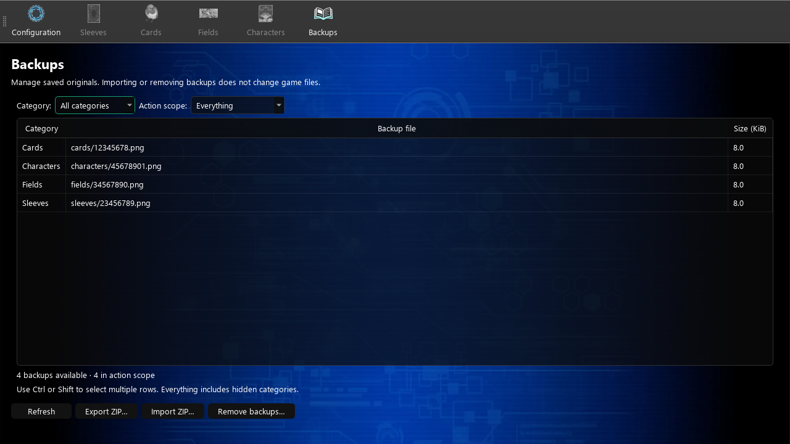

# Backups

Open **Backups** in the navigation toolbar to manage the saved originals in the app's local `backups/` folder. This page works before a game path is configured. Open the page or click **Refresh** to rescan files after editing assets.

The table shows each file's category, relative path, and size. Known categories are **Cards**, **Sleeves**, **Fields**, and **Characters**; other folders are listed by their folder names.

## Choose backups

Use **Category** to filter the table, then choose an **Action scope**:

- **Everything** includes all files, including categories hidden by the filter.
- **Current category** includes every file in the chosen category. Choose a specific category first.
- **Selected backups** includes highlighted rows. Use Ctrl-click or Shift-click to select multiple files.

## Export and import

Click **Export ZIP…** to save the chosen scope to an archive. Export preserves paths relative to `backups/` and leaves local files in place.

Click **Import ZIP…**, choose an archive, then choose everything, a category, or individual files in the preview. Click **Import**. For existing files, choose **Yes** to replace them, **No** to keep them and import only new files, or **Cancel** to stop.

Archives should contain category folders directly, such as `cards/12345678.png`, without an extra `backups/` folder. Use backups created for Duel Links; archives from other games may contain unrelated files. Importing stores backups locally. Apply an original through the relevant editor's restore control or **Restore All** in Configuration.

Unsafe paths, duplicate paths, symbolic links, and archives larger than 4 GiB or 100,000 files are rejected. Selected files are checked before local files change. A disk or write failure can still leave a partial import; resolve the failure, refresh, and retry.

## Remove backups

Choose a scope, click **Remove backups…**, and confirm the file count. Removal is permanent, so export files you may need first. Importing and removing backups updates backup indicators in loaded asset lists. Neither action changes game files.

Archives contain saved originals only, without settings, metadata, or game installations. Enable automatic backup creation in [Configuration](config.md) before editing assets; it does not create originals retroactively.
