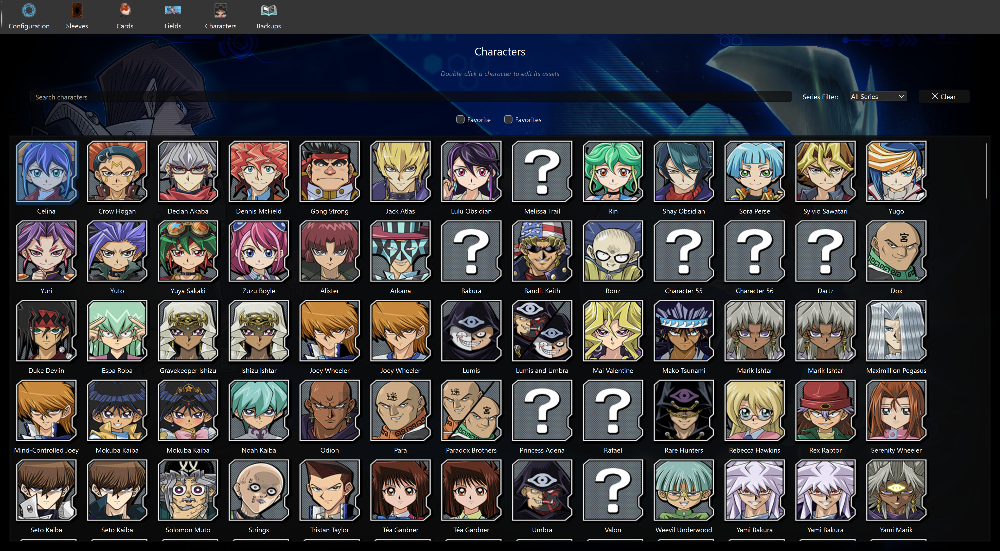
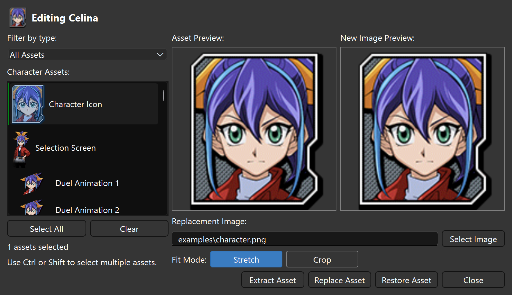

# Character Editor

Open **Characters** to browse the character metadata downloaded through Configuration.
Select a character to enable its **Favorite** control, or double-click to open its assets.

## Find a character

Type a name in **Search characters**. Results update after a short pause; Enter
searches immediately. Search works together with the series selector and **Favorites**
filter. The **Clear** button beside the series filter resets all three. Characters are ordered by series and name;
missing names appear as `Character <ID>`. Hover over a thumbnail for its full name.

## Edit character assets

1. Double-click a character, then choose **All Assets**, **Duel Assets**,
   **Dialog Assets**, or **Miscellaneous** in **Filter by type**.
2. Select an asset to view its installed texture. Use Ctrl-click or Shift-click
   for multiple selections, **Select All** for the current list, or **Clear** to deselect.
3. Choose **Select Image** or drop an image into the dialog. The source preview
   shows the replacement before you apply it.
4. Choose **Stretch** to resize the image to the target texture, or **Crop** to
   select the source area. Drag the crop rectangle or its handles to adjust it.
5. Click **Replace Asset**, or **Replace N Assets** for a selection of several assets.

For one asset, Crop uses its visible content proportions when those can be read.
For multiple assets, the crop is freeform and shared by the selection. Each target
fits the selected area into its original content bounds, preserving transparent
margins and texture dimensions. Stretch resizes to the whole texture.

## Extract, restore, and back up

**Extract Asset** saves the selected textures under `images/characters/`.
**Restore Asset** restores selected textures with saved originals. Both actions also
work on multiple selections; their button labels show the selection count.
An action reports any assets that failed, so check the result before continuing.

With automatic backups enabled, replacement saves each bundle's original texture
under `backups/characters/`. Editing the same bundle again keeps the existing
original. Use [Backups](backups.md) to export or import these files, and
[Configuration](config.md) for **Restore All**.

Only assets listed in the metadata and downloaded in the selected game account
can be previewed or edited. If a preview is unavailable, check the account path,
download the assets in Duel Links, and refresh metadata with **Check**.
