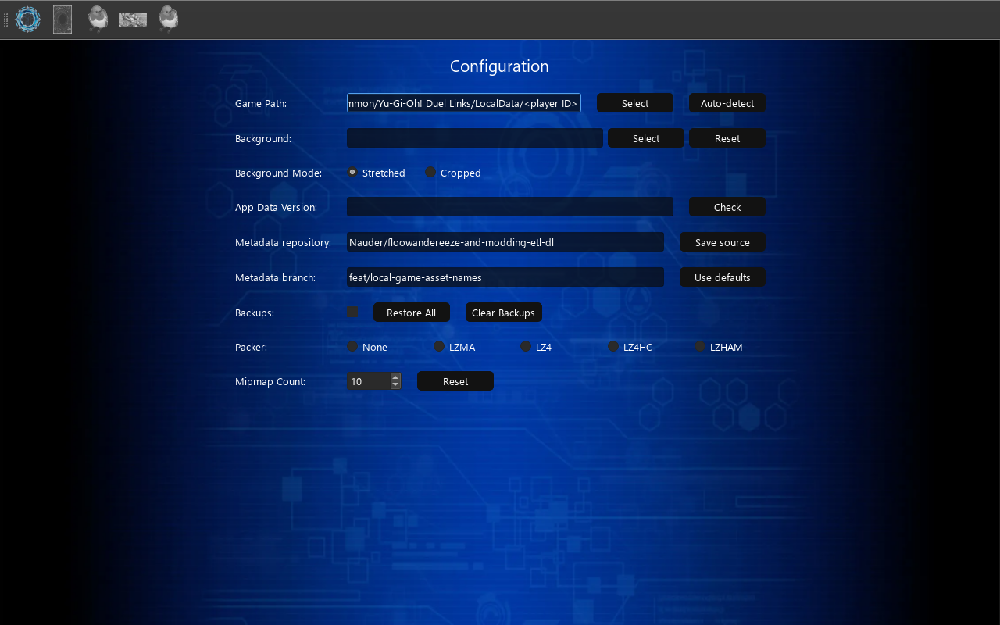

# Configuration

The Configuration page allows you to manage application settings and perform maintenance tasks in Yu-Gi-Oh! Duel Links. This page provides functionality to configure game paths, update data, manage backups, and customize the application appearance.

## Features

- Steam game discovery and manual game path configuration
- Data update management
- Backup system configuration
- Application appearance customization
- Asset compression settings
- Mipmap count configuration
- Bulk backup management

## Interface Elements

### Game Path Settings

- **Auto-detect**: Find Duel Links accounts across your Steam libraries and select the account to use
- **Game Path**: Select a Duel Links installation, its LocalData folder, or a player ID folder
- **Check Button**: Check and update app data
- **Version Display**: Show current data version

### Metadata Source

- **Metadata source**: GitHub repository in `owner/repository` format, or a local repository folder. The default is `Nauder/floowandereeze-and-modding-etl-dl`.
- **Browse local…**: Select the root of a local ETL checkout containing `data/version.txt` and the four asset Parquet files.
- **Metadata branch**: GitHub branch or ref to download. Leave blank to use the repository's default branch. Disabled for local sources.
- **Save source**: Save these settings for future checks.
- **Use defaults**: Restore the default repository and clear the branch override.

To test the asset-name branch, enter `feat/local-game-asset-names` in Metadata branch,
then click **Check**. Check saves the source fields and downloads all asset datasets
from that source. Switching sources refreshes the data even when the version dates
match. The previous successful source and version are kept if a download fails.
To return to the default data, click **Use defaults**, then **Check**.

For local testing, click **Browse local…**, select your ETL repository, then click
**Check**. The app reads files from the current working tree, including uncommitted
changes, without contacting GitHub. Each local check reloads all four datasets even
when `version.txt` has not changed. Rerun the ETL export and click **Check** to test
new data; committing or publishing it is unnecessary. Missing files are reported
before the source is saved.

### Backup Management

- **Enable Backups**: Toggle automatic backup creation
- **Restore All**: Restore all modified assets with backups to their original state
- **Clear Backups**: Delete all backup files

Use the [Backups tab](backups.md) to browse saved originals, export or import ZIP archives, or remove selected backups.

### Appearance Settings

- **Background Image**: Set custom application background
- **Reset Background**: Remove custom background

### Asset Settings

- **Mipmap Count**: Configure texture mipmap levels (Default 10)
- **Compression Options**:
  - None
  - LZMA
  - LZ4
  - LZ4HC
  - LZHAM

## Usage

1. **Setting Game Path**
      - Click "Auto-detect" beside the game path and select a downloaded account
      - You can also select the installation, LocalData folder, or player folder manually
      - When several accounts are available, choose the one to edit
      - Path is validated before being saved; asset tabs become available immediately

2. **Updating Data**
      - Set game path first
      - Click "Check" to check for new data
      - Updates are downloaded automatically if available

3. **Managing Backups**
      - Toggle "Enable Backups" to control automatic backup creation
      - Use "Restore All" to revert all changes
      - Use "Clear Backups" to remove backup files

4. **Customizing Appearance**
      - Click "Select Background" to choose custom background
      - Use "Reset Background" to remove custom background
      - Changes are applied immediately
      - The app has a dark theme, so bright backgrounds are not recommended

5. **Configuring Asset Settings**
      - Set desired mipmap count (default: 10)
      - Choose compression method for new assets
      - Settings affect all new asset replacements

## Notes

- Game path must be set before using most features
- Data updates require a valid game path first
- Backup system affects all asset types
- Asset settings affect all new replacements
- Asset tabs load when first opened and refresh after successful data updates
- Backups create local copies of assets, so they take storage space
- Backgrounds can be stretched to fit or cropped to cover the window while preserving proportions
