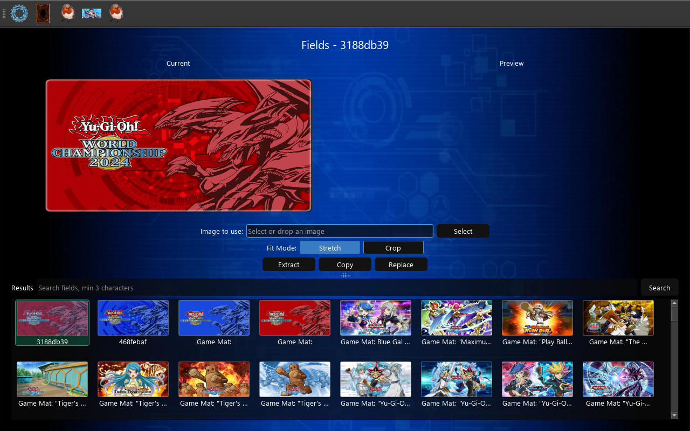

# Playmat Editor

The Playmat Editor page allows you to modify playmat textures in Yu-Gi-Oh! Duel Links. This page provides
functionality to view, replace, and manage playmat assets.

## Resizing and image fitting

Resize the window to scale the Current and Preview images. Drag the dotted divider
between the editor and results to change their relative heights; the app remembers
this position and the window size. Results wrap into columns as space becomes available.
On smaller windows, scroll the editor to reach its controls.

Select or drop an image, then choose **Stretch** or **Crop**. In Crop mode, drag the
crop rectangle or its corner handles. Your crop stays in place when the window resizes.

## Features

- Playmat list with preview
- Playmat texture replacement
- Automatic backups of both playmat bundles when backups are enabled
- Texture extraction
- Bundle copying
- Real-time preview updates

## Search

Type at least three characters of an asset name or bundle ID, then press Enter or
click Search. Suggestions match any part of a name. Clear the search box to show
all results again. Asset names appear below the thumbnails; hover for the full name
and bundle ID. Unnamed assets display their bundle ID.

Use **Check** on the Configuration page after upgrading to download the new asset
names. Existing favorites and backup flags for sleeves and playmats are kept.

## Interface Elements

### Playmat List

- Displays all available playmats
- Click on a playmat to select it for editing
- Shows the playmat bundle information

### Preview Section

- Shows the currently selected playmat
- Displays the playmat's bundle information
- Updates in real-time when changes are made

### Action Buttons

- **Select Image**: Choose a new playmat texture image
- **Replace**: Apply the selected image to the playmat
- **Copy**: Copy the playmat bundle to the fields folder
- **Extract**: Extract the playmat texture

## Usage

Enable backups in Configuration to save the original small and medium playmat
textures under `backups/fields/` before replacement. Existing backups are kept
when replacing the same playmat again. Use Configuration's **Restore all** action
to restore backed-up textures, or the Backups page to export and import them.

1. **Selecting a Playmat**
      - Click on a playmat in the list to select it
      - The preview will update to show the selected playmat
      - Action buttons will become enabled

2. **Replacing Playmat Texture**
      - Click "Select Image" to choose a new playmat texture
      - Preview the selected image
      - Click "Replace" to apply the changes

3. **Extracting Textures**
      - Select a playmat
      - Click "Extract" to save the texture
      - The texture will be saved to the "fields" folder

4. **Copying Playmats**
      - Select a playmat
      - Click "Copy" to save the bundle
      - The playmat will be copied to the "fields" folder
